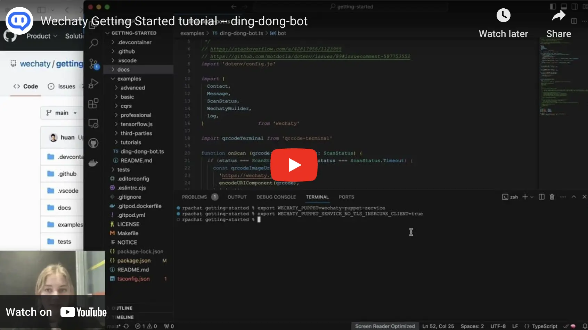

# Wechaty Getting Started [](https://wechaty.js.org)

[](https://github.com/wechaty/getting-started/actions?query=workflow%3A%22Node.js+CI%22)

[](https://www.typescriptlang.org/)
[](https://nodejs.org/api/esm.html)

## About Wechaty

[Wechaty](https://github.com/wechaty/wechaty/) is a Conversational RPA(Robotic Process Automation) SDK(Software Development Kit) for Chatbot Makers. It's well designed with an easy to use API. It supports all operating systems including Linux, OSX, Win32, Docker, and lots of IMs(Instant Messaging services) including WeChat, WeCom, Whatsapp, Lark, Gitter, etc.

As a developer, you can use Wechaty to easily build your bot, effectively manage message sending and receiving, room creation and sending out invitations, contact friends, and delightfully add artificial intelligence between users and your bot.

## About Wechaty Getting Started Project

If you are a total beginner to Wechaty, this project is the best starting point for you. You can run it on Google Cloud Shell or on a local setup on your machine as described in the sections below.

If you encounter difficulties or have any questions, you are welcome to ask for help in our Discord Community at <https://discord.gg/7q8NBZbQzt>.

This repository tracks Wechaty 2. It needs Node.js 26 or newer and TypeScript 7.

- **`wechaty@0.x`** - To use the Wechaty v0.x, please visit the [Wechaty Getting Started v0.x](https://github.com/wechaty/getting-started/tree/v0.x) branch.

### Features of Wechaty Getting Started project

1. It runs on Linux x64 and arm64 (glibc 2.38 or newer), macOS on Apple Silicon, and Windows x64.
1. The starter bot uses [Wechaty Puppet Neo](https://www.npmjs.com/package/wechaty-puppet-neo).
1. It replies with a `dong` message when it receives a `ding` message.

### Wechaty Getting Started video tutorial

<div align="center">
<a target="_blank" href="https://youtu.be/GdmikkU4ZfM?si=cpsuh7RyQjtgLE5F"></a>
</div>

Above is a short run-through of the ding-dong bot.

### Running Wechaty Getting Started Project on a cloud based IDE

Google Cloud Shell is an online development and operations environment accessible anywhere with your browser. You can run this project on Google Cloud Shell by clicking the button below.

[![Open in Cloud Shell][shell_img]][shell_link]

> Generated via [open-in-cloud-shell](https://cloud.google.com/shell/docs/open-in-cloud-shell)

After opening the Google Cloud Shell editor, there should be an open tutorial in the right panel which you can follow to learn more about Wechaty.

Learn more about running this project on Google Cloud Shell from our blog: [Google Cloud Shell Tutorials for Wechaty, @huan, Feb 20, 2021](https://wechaty.js.org/2021/02/20/google-cloud-shell-tutorials/)

### Running Wechaty Getting Started project on your local machine

#### Prerequisites

For you to run this project on your local machine, you need [Node.js](https://nodejs.dev/) v26 or newer and npm 10 or newer. Run `node -v` and `npm -v` to check. A current Node.js 26 release looks like `v26.13.1`.

Install Node.js from the links below when it is missing or older than 26:

- [Windows](https://nodejs.org/en/download/package-manager/#windows)
- [Linux(Debian/Ubuntu)](https://nodejs.org/en/download/package-manager/#debian-and-ubuntu-based-linux-distributions)
- [macOS](https://nodejs.org/en/download/package-manager/#macos)

> Node.js for other platforms can be found at <https://nodejs.org/en/download/package-manager/>

Puppet Neo publishes prebuilt native addons for:

| Platform | Node.js |
| :--- | :--- |
| Linux x64 and arm64 | glibc 2.38 or newer |
| macOS | Apple Silicon |
| Windows x64 | x64 Node.js, including Windows on ARM under x64 emulation |

Run `node -p process.arch` on Windows on ARM. It needs to print `x64`.

#### Step 1: Clone this Repository

You need to clone this repository to your local machine and then switch to `wechaty-getting-started` directory by running the commands below.

```sh
git clone https://github.com/wechaty/getting-started.git
cd getting-started
```

#### Step 2: Install Dependencies

You need to install dependencies by running the command below.

```sh
npm install
```

`npm install` selects the newest Wechaty 2 release, including a later alpha, a beta, or a stable 2.x.

#### Step 3: Run the Bot

```sh
npm start
```

The same command works on Linux, macOS, and Windows. Node.js runs `examples/ding-dong-bot.ts` directly. The bot is built with `new Wechaty(...)` and `new PuppetNeo()`.

A QR code is printed in the terminal. Scan it with WeChat. Neo keeps the login in memory, so every start prints a new QR code.

After the bot logs in, send `ding` from another WeChat account, in a direct chat or in a group that includes this account. The bot replies `dong`.

You are all set!

#### Step 4: Troubleshooting

If you run into problems while following the above steps, check the items below. You are also welcome to ask questions in our [Discord community](https://discord.gg/7q8NBZbQzt).

1. `node -v` is v26 or newer, and `npm -v` is 10 or newer.
1. On Linux, `ldd --version` reports glibc 2.38 or newer.
1. `node -p process.arch` is `x64` on Linux x64 and Windows, or `arm64` on Linux arm64 and macOS Apple Silicon.

## Wechaty Puppet Neo

The ding-dong bot in this repository uses [wechaty-puppet-neo](https://www.npmjs.com/package/wechaty-puppet-neo) through `Wechaty`.

| Provider | NPM | Login |
| :--- | :--- | :--- |
| Puppet Neo | `wechaty-puppet-neo` | In memory. A new QR code on every start. |

```ts
import { Wechaty } from 'wechaty'
import { PuppetNeo } from 'wechaty-puppet-neo'

const bot = new Wechaty({
  name: 'ding-dong-bot',
  puppet: new PuppetNeo(),
})
```

Learn more about installing Wechaty on windows from this [blog post](https://wechaty.js.org/2018/07/24/wechaty-installation-in-windows-10/).

## Advanced tutorials

### 1. Wechaty Tutorial

<div align="center">
<a target="_blank" href="https://wechaty.js.org/2017/01/01/getting-started-wechaty/"></a>
</div>

Above is a 10 minute video tutorial. It is using version 0.14 or older versions of Wechaty therefore it is also outdated. It is a good way to start if you are new to Wechaty.

### 2. More Examples

> Note: Before you attempt more examples, make sure you have tried out the wechaty getting started project in this repository.

- [Official Wechaty Examples Directory](https://github.com/wechaty/getting-started/tree/main/examples)

`examples/cqrs/` is kept for a future Wechaty 2 upgrade and is excluded from the root TypeScript check.

#### Verification

Run linting, TypeScript checks, and smoke tests locally:

```sh
npm run lint
npm test
npm run test:unit:deno
```

## API REFERENCE

1. Official API Docs: <https://wechaty.js.org/docs/api>

## MORE RESOURCES

### 1. Docker Wechaty Getting Started

[](https://github.com/wechaty/docker-wechaty-getting-started)

<https://github.com/wechaty/docker-wechaty-getting-started>

### 2. Heroku Wechaty Getting Started

[](https://github.com/wechaty/heroku-wechaty-getting-started)

<https://github.com/wechaty/heroku-wechaty-getting-started>

### 3. Wechaty Home

<https://wechaty.github.io>

## FAQ

### 1. How do I log in

`npm start` prints a QR code. Scan it with WeChat and confirm the login on the phone. Neo stores that login in memory, so stopping the process and starting it again prints a new QR code.

### 2. What is a `Puppet` in Wechaty

The term [Puppet](https://github.com/wechaty/wechaty/wiki/Puppet) in Wechaty is an abstract class for implementing protocol plugins. The plugins are the components that help Wechaty control a chat service, which is why they are called puppets.

This repository uses [PuppetNeo](https://www.npmjs.com/package/wechaty-puppet-neo). Learn more from the documentation at [Wechaty Puppet](https://wechaty.js.org/docs/specifications/puppet).

## Wechaty Getting Started in Multiple Languages

[](https://github.com/wechaty/python-wechaty)
[](https://github.com/wechaty/go-wechaty)
[](https://github.com/wechaty/java-wechaty)
[](https://github.com/wechaty/scala-wechaty)
[](https://github.com/wechaty/php-wechaty)
[](https://github.com/wechaty/dotnet-wechaty)

- [TypeScript Wechaty Getting Started](https://github.com/wechaty/getting-started)
- [Python Wechaty Getting Started](https://github.com/wechaty/python-wechaty-getting-started)
- [Go Wechaty Getting Started](https://github.com/wechaty/go-wechaty-getting-started)
- [Java Wechaty Getting Started](https://github.com/wechaty/java-wechaty-getting-started)
- [Scala Wechaty Getting Started](https://github.com/wechaty/scala-wechaty-getting-started)
- [PHP Wechaty Getting Started](https://github.com/wechaty/php-wechaty-getting-started)
- [.NET(C#) Wechaty Getting Started](https://github.com/wechaty/dotnet-wechaty-getting-started)

## History

### main (Wechaty 2)

Node.js 26, TypeScript 7, and [wechaty-puppet-neo](https://www.npmjs.com/package/wechaty-puppet-neo). The starter bot uses `new Wechaty(...)` and `new PuppetNeo()`.

### main v1.18 (Mar 14, 2022)

Add CQRS Wechaty examples.

### v1.11 (Oct 30, 2021)

Branch: [v1.11](https://github.com/wechaty/getting-started/tree/v1.11): release v1.11 of Wechaty.

1. v0.13: Enable ESM (ES Module) support ([chatie/tsconfig#16](https://github.com/Chatie/tsconfig/issues/16))

### v0.8 (Feb 20, 2021)

[![Open in Cloud Shell][shell_img]][shell_link]

Using Google Cloud Shell for a quick setup!

### v0.0.1 (Jan 12, 2017)

Init version

## Contributors

[](https://sourcerer.io/fame/huan/wechaty/getting-started/links/0)
[](https://sourcerer.io/fame/huan/wechaty/getting-started/links/1)
[](https://sourcerer.io/fame/huan/wechaty/getting-started/links/2)
[](https://sourcerer.io/fame/huan/wechaty/getting-started/links/3)
[](https://sourcerer.io/fame/huan/wechaty/getting-started/links/4)
[](https://sourcerer.io/fame/huan/wechaty/getting-started/links/5)
[](https://sourcerer.io/fame/huan/wechaty/getting-started/links/6)
[](https://sourcerer.io/fame/huan/wechaty/getting-started/links/7)

## Maintainers

[@wechaty/contributors](https://github.com/orgs/wechaty/teams/contributors/members)

## Copyright & License

- Code & Docs © 2018-now Huan and [Wechaty Contributors](https://wechaty.js.org/contributors/)
- Code released under the Apache-2.0 License
- Docs released under Creative Commons

[shell_img]: https://gstatic.com/cloudssh/images/open-btn.svg
[shell_link]: https://ssh.cloud.google.com/cloudshell/editor?cloudshell_git_repo=https%3A%2F%2Fgithub.com%2Fwechaty%2Fgetting-started&cloudshell_open_in_editor=examples/ding-dong-bot.ts&cloudshell_workspace=.&cloudshell_tutorial=examples/tutorials/google-cloud-shell-tutorial.md
